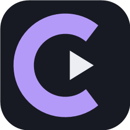

# Cinevo 0.1.1 · Beta

**Seu cinema, em casa.** Gerenciador de filmes locais para Windows, com interface em português, instalador simples e atualizações pelo GitHub.

[Baixar o instalador Beta](https://github.com/BlackGen3ral/cinevo/releases/download/v0.1.1-beta.2/Cinevo-Setup.exe) · [Versões](https://github.com/BlackGen3ral/cinevo/releases)

O Cinevo está em **Beta**: esta é a versão inicial de desenvolvimento, ainda sujeita a ajustes e melhorias.



## Começar

1. Baixe e execute **Cinevo-Setup.exe**.
2. Conclua a instalação. Não precisa instalar .NET nem ter acesso de administrador.
3. Abra o Cinevo e clique em **Adicionar pasta**. Escolha as pastas dos seus filmes, inclusive em discos externos.
4. As capas são buscadas automaticamente pelo título e ano. Use **Buscar capas** para tentar novamente, ou **••• → Buscar / corrigir capa pelo nome** para escolher outro resultado.
5. Use **Assistir** para reproduzir dentro do Cinevo. Em **•••**, edite título, ano, gênero, capa, notas, avaliação e os estados de favorito/assistido.

Requisitos: Windows 10/11 x64. O motor LibVLC e seus módulos já vêm no instalador: não é necessário instalar VLC ou outro player. Arquivos incompletos, protegidos por DRM ou com formatos incomuns ainda podem falhar na reprodução.

## Recursos

- Indexação recursiva em segundo plano, cancelável e sem duplicatas por caminho.
- Reconhecimento de títulos e anos a partir do nome do arquivo.
- Busca por título, ano, gênero e caminho; filtros para favoritos e assistidos.
- Ordenação por título, data de adição, ano e avaliação.
- Interface com grade de pôsteres responsiva, destaque para a próxima sessão e indicação do progresso.
- Capas automáticas da Wikipédia com cache local, correção por busca e imagens escolhidas do computador.
- Player integrado: pausa, volume, busca na linha do tempo, saltos de 10 segundos, tela cheia, faixas de áudio, legendas internas e arquivo de legenda externo.
- Continuação do ponto salvo e marcação de assistido ao atingir o final.
- Grade com virtualização por linhas e decodificação das capas em resolução limitada para reduzir uso de memória.
- Anotações e avaliações de 1 a 5 estrelas.
- Discos ausentes mantêm seus registros e preferências no catálogo.
- Backup exportável e cópia automática da última gravação do catálogo.
- Instalador por usuário, atalhos e desinstalador.

O Cinevo não move, apaga ou envia seus vídeos. A busca de capas envia somente o título e ano à Wikipédia; pode ser desativada em **Configurações**. Seus caminhos e anotações ficam no computador. As capas e seus direitos pertencem aos respectivos titulares; a origem fica acessível nos detalhes. Correspondências são aproximadas e nem todos os filmes terão um pôster disponível. Capas manuais são preservadas. Filmes divididos em arquivos separados aparecem como registros separados.

No player: **Espaço** pausa/continua; **← / →** recuam/avançam 10 segundos; **F** alterna tela cheia; **Esc** sai da tela cheia ou volta à biblioteca; **M** ativa/desativa o som. O progresso é salvo a cada dez segundos e ao fechar o player. A continuação começa após 30 segundos de progresso salvo. No final, o filme é marcado como assistido automaticamente; você pode alterar isso nos detalhes.

## Atualizações

A versão instalada verifica a release mais recente do GitHub ao abrir. Se houver uma versão superior, baixa o instalador, valida seu SHA-256 e instala ao fechar o app. Você também pode usar **Instalar atualização**. É possível desativar esse comportamento em **Configurações**.

Sem conexão, o catálogo continua funcionando. A primeira versão não tem certificado de assinatura de código; o Windows pode exibir uma mensagem de editor desconhecido. A verificação SHA-256 detecta corrupção do download, mas não substitui assinatura de código.

## Seus dados

Catálogo: `%LOCALAPPDATA%\Cinevo\library.json`.

Cópia da gravação anterior: `library.json.bak`. Capas copiadas para a subpasta `covers`. O desinstalador preserva esse diretório para permitir reinstalação sem perder sua coleção. Para restaurar uma cópia, feche o app e substitua `library.json` pelo JSON exportado. Não publique o catálogo: ele contém caminhos locais e suas anotações.

## Desenvolvimento e publicação

WPF, C# e .NET 10. Sem dependências NuGet de terceiros. O runtime .NET e as bibliotecas nativas oficiais LibVLC 3.0.24 são incluídos no instalador. Downloads nativos e código-fonte são fixados e verificados por SHA-256.

```powershell
dotnet run --project tests/Cinevo.Tests.csproj -c Release
./scripts/build.ps1 -Version 0.1.1-beta.2
```

Pré-requisitos de compilação: .NET SDK 10 e Inno Setup 6 ou 7. Para um compilador fora do local padrão, passe `-InnoCompiler C:\caminho\ISCC.exe`. `scripts/icon.ps1` regenera o ícone ICO em seis tamanhos e a imagem PNG.

Cada melhoria deve incrementar o núcleo da versão e receber uma nova tag, por exemplo `v0.1.2-beta.3`. O workflow `.github/workflows/release.yml` compila no Windows, executa testes do catálogo, capas, atualização e reprodução real de vídeo/áudio com LibVLC, e publica `Cinevo-Setup.exe`, `SHA256SUMS.txt` e o código-fonte correspondente do VLC. O app instalado recebe essa release na próxima verificação. Veja `AGENTS.md` para a autorização permanente e as regras de publicação deste projeto.

Para testes de interface sem tocar no catálogo real, defina `CINEVO_TEST_DATA` com uma pasta temporária antes de executar a cópia de desenvolvimento. O processo usa um catálogo e uma instância separados. Nunca use dados pessoais em capturas ou fixtures publicadas.

## Licença

Código do Cinevo sob MIT. LibVLC e módulos VLC têm licenças LGPL/GPL; as licenças, os autores e a origem do código-fonte são preservados. Veja [THIRD-PARTY-NOTICES.md](THIRD-PARTY-NOTICES.md). O runtime [.NET](https://github.com/dotnet/runtime/blob/main/LICENSE.TXT) e o [Inno Setup](https://jrsoftware.org/isinfo.php) também têm suas próprias licenças.
